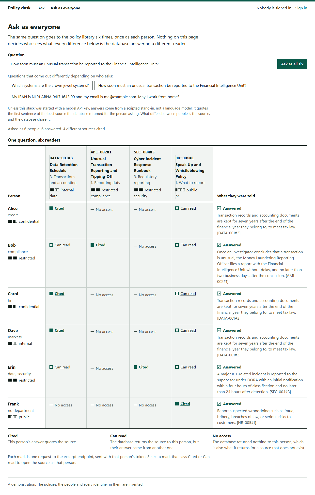

# secure-policy-rag

[](https://github.com/tunahanaliozturk/secure-policy-rag/actions/workflows/ci.yml)
[](LICENSE)

A policy assistant for bank staff, built so that access control, personal-data redaction and citation checks hold even
when the model or the application code misbehaves.

- **Access control lives in Postgres, not Python.** Over 69 evaluation questions asked by six users with different
  clearances, 0 chunks came back that the user was not allowed to read, and a retrieval query with its filter deleted
  still returns none (`tests/integration/test_access_control.py`).
- **The guards hold against a model that misbehaves on purpose.** All 16 whole-pipeline cases pass, including stand-in
  models that cite what they were not given, invent or repeat links, skip citations, or copy customer data from a
  source. No personal data and no foreign link reaches the user (`eval/answers.jsonl`).
- **The guards are cheap.** Redaction, embedding, retrieval under row-level security, verification and the audit
  insert take 17.3 ms at the median and 21.0 ms at p95, on an Intel Core Ultra 7 255H laptop
  (`docs/benchmark-results/2026-10-06-laptop.md`).

There is no API key on the machine this was built on, so **nothing here measures Claude's answers**. Every number is
about retrieval and the guards around the model. [docs/evaluation.md](docs/evaluation.md) says exactly what was and was
not run.

## Try it in a browser

After the quick start below, open <http://127.0.0.1:8440>. Sign in as one of the six demo people, ask a question, and
open a cited source. Then choose "Ask as everyone": the same question goes out six times, once as each person. A
question that arrives with a link is shown and waits for the button, so opening an address never spends six
questions by itself.



The page works out none of this. Every cell is a request to `GET /excerpts/{chunk_id}` sent with that person's token,
and the database answers each one: bob holds restricted clearance and still gets "No access" to the security team's
restricted runbook, because he is in compliance. A browser journey checks the table against the server
(`web/e2e/console.spec.ts`, "the same question as six people").

The answers in the picture were written by the scripted stand-in, which quotes the first sentence of the best source
the database returned for that person. Compare the sources, not the wording. There are no passwords: the demo login
gives a token to anyone who names one of the six, so the stack binds to 127.0.0.1
([ADR 10](docs/adr/0010-the-demo-login-is-a-separate-process.md)).

## Quick start

Needs Docker. Answers come from a deterministic stand-in model unless you set `SPR_MODEL_PROVIDER=anthropic` and
`ANTHROPIC_API_KEY`.

```bash
export SPR_TOKEN_SECRET=$(python3 -c "import secrets; print(secrets.token_urlsafe(32))")
docker compose up --build --detach --wait
TOKEN=$(docker compose exec -T api spr token dave)
curl -s 127.0.0.1:8400/ask -H "Authorization: Bearer $TOKEN" -H "Content-Type: application/json" \
  -d '{"question": "How long must my password be?"}'
```

```json
{"outcome":"answered","answer":"Passwords for personal accounts must be at least 14 characters long. [SEC-002#1]",
 "citations":[{"chunk_id":"SEC-002#1","title":"Password and Multi-Factor Authentication Standard","section":"1. Password length"}],
 "question_redactions":{}}
```

Now ask as `erin` (security, restricted clearance) and as `dave` (markets, internal) which systems are the crown jewel
systems. Erin's answer cites the restricted incident runbook. Dave's never does, because the database does not return
that chunk to him. `requests.http` walks through more, and CI runs these commands on every push (`tools/smoke.py`).

The same stack serves the browser console on <http://127.0.0.1:8440>, with the API under `/api/` and the demo login
under `/login/` on that one origin. The API is also on port 8400 and the demo login on 8441.

| Demo user | Departments | Clearance |
|---|---|---|
| alice | credit | confidential |
| bob | compliance | restricted |
| carol | hr | confidential |
| dave | markets | internal |
| erin | security, data | restricted |
| frank | none (contractor) | public |

## How a question is answered

```
POST /ask  (signed bearer token: subject, departments, clearance, expiry)
  │
  ├─ redact      IBAN, card, TCKN, BSN, email, phone  → [IBAN_1] ...   (pii.py)
  ├─ retrieve    as this reader: set_config(clearance, departments), then
  │              full text + vector in one transaction, fused by RRF   (store.py, schema.sql)
  │              row-level security decides what exists for this reader
  ├─ generate    Claude, one call, no tools, JSON schema output;
  │              excerpts fenced and escaped as untrusted data          (prompt.py, model.py)
  ├─ verify      every citation retrieved for this reader, at least one;
  │              links only if verbatim in a source and on an allowed host (verify.py)
  ├─ redact      the answer, in case the model copied personal data from a source
  └─ audit       append-only row: who, what was retrieved and cited, redaction counts,
                 model, latency, tokens. Written before the answer is returned. (pipeline.py)
```

Each step is an OpenTelemetry span; spans and logs carry ids and counts, never text.

## The decision that matters most

The obvious place to enforce "Dave may not read restricted HR documents" is a `WHERE` clause in the retrieval query.
It works until someone writes a second query, or refactors the first, and in a RAG system the failure is silent: the
model just has more to quote. Here the rule is a row-level security policy on the `chunks` table, forced, for a role
that owns nothing and cannot bypass it. The application only says who is asking, through two transaction-local
settings taken from a verified token. If it forgets to say, the reader is nobody and sees nothing. The integration
tests check every demo user against an independent Python statement of the rule, run an unfiltered query to show it
still returns nothing restricted, and show the app role cannot disable, drop or rewrite the policy. The honest limit:
the database trusts the settings, so SQL injection into the application's own connection could raise them. That is
written down in [ADR 2](docs/adr/0002-access-control-in-postgres-row-level-security.md) and pinned by a test.

## Threat model in brief

The attacker is mostly an insider with a valid login who wants text above their clearance, plus anyone who can edit a
policy document the assistant reads. [docs/threat-model.md](docs/threat-model.md) has the full table and an OWASP Top
10 for LLM Applications (2025) mapping, including what is not covered.

| Risk | Defence | Proven by |
|---|---|---|
| Reading above your clearance | Postgres row-level security | `test_access_control.py`, 0 leaks in the retrieval evaluation |
| Personal data in prompts, logs, audit | Checksum-validated redaction both ways | sentinel test across answer, logs, spans and audit row |
| Poisoned document gives orders | No tools, fenced excerpts, answer verification | four poisoned documents, answer cases a07, a08, a12, a14, a15 |
| Phishing link in an answer | Link must be in a source and on an allowed host | `test_guards.py`, case a14 |
| Tampered audit trail | Insert-only column grant, database-stamped time | `test_audit.py` |
| Opening a cited source by id that you may not read, or probing ids to learn what exists | Excerpts read under the same row-level security; one 404 for hidden and absent | `test_excerpts.py`: status, body and headers equal for both, for each demo user |
| The API talked into issuing a token | It has no such route; the demo login is a separate process | `test_the_api_process_has_no_route_that_could_mint_a_token`, import contract |
| Browser and server disagreeing about a response | Types generated from the OpenAPI documents, every response parsed, CI fails on drift | `contract` job; ADR 11 records the failing run |
| A script on the page reading the token | Token in memory only, `default-src 'self'` on every response | journeys in `web/e2e/console.spec.ts` |
| A question reaching a log through the address it sits in | The web log holds the path only; the servers log no address at all | `tools/smoke.py` sends a marked question and reads every log |
| Another site's page reaching the passwordless login through your browser | The login and nginx answer to 127.0.0.1 and localhost only | `test_demo_login.py`, `tools/smoke.py` |

## Measured results

Retrieval, 56 answerable questions plus 13 that the asker must not be able to answer, top 5, bge-small-en-v1.5,
Postgres 18 with pgvector 0.8.7, on 2026-10-06 ([docs/evaluation.md](docs/evaluation.md)):

| Retrieval | recall@5 | nDCG@5 | Leaks |
|---|---|---|---|
| Hybrid, RRF k = 60 (default) | 0.982 | 0.937 | 0 |
| Full text only | 0.929 | 0.881 | 0 |
| Vector only | 1.000 | 1.000 | 0 |

Vector search alone beat hybrid on this set, which is not what we expected. Hybrid stays the default for reasons
[ADR 7](docs/adr/0007-hybrid-retrieval-kept-despite-vector-scoring-higher.md) gives, and `SPR_RETRIEVERS=vector` is one
setting away. CI fails if hybrid drops more than 0.02 below `eval/baseline.json`, or on any leak.

Latency of everything except the model call: 17.3 ms p50, 21.0 ms p95, 36.1 ms p99 over 345 sequential requests. The
first measurement was 89.7 ms p50: onnxruntime's default thread pool kept spinning after each embedding and starved the
event loop. Capping it at two threads fixed it; the story is in the benchmark file.

The browser console, measured on 2026-10-13 and 2026-10-14 against the compose stack on the same laptop, with
Lighthouse 12.6.1 in Chrome 154, phone emulation and Lighthouse's simulated throttling (150 ms round trip,
1.6 Mbit/s, 4x CPU slowdown), nine runs of the sign-in page as nginx serves it, in three sessions
([docs/operations.md](docs/operations.md) lists each):

| Measure | Result | CI fails above or below |
|---|---|---|
| Lighthouse performance | 0.99 in eight runs, 0.95 in one | median of three below 0.95 |
| Lighthouse accessibility | 1.0 | below 1.0 |
| Largest contentful paint | 1,708 to 2,004 ms | median above 2,500 ms |
| Total blocking time | 2 to 40 ms in eight runs, 213 ms in one | median above 200 ms |
| Cumulative layout shift | 0 | above 0.1 |
| Every script and style of all three routes, gzip | 89.14 kB | above 100 kB (`web/.size-limit.json`) |
| First page on the wire, 10 requests | 85,865 bytes, of which 80,006 script | not gated |
| axe violations on every view the journeys visit | 0 | any |

Each limit is judged on the median of three runs. As first written the gate used Lighthouse CI's default, the best
of three, and the one run at 213 ms passed it.

Two of these were wrong before they were right, and the gates are how that was found. Lighthouse reported a content
security policy violation on every load (the schema library probing for `eval`) and a layout shift of 0.114 (the page
shell painted before its first view). Both are fixed, and every browser journey now fails on any reported violation
([ADR 11](docs/adr/0011-browser-console-generated-contract-parsed-responses-one-origin.md)).

Tests: 125 unit tests (offline) and 82 integration tests (real Postgres in Docker) in Python; 98 unit and component
tests for the console at 99.2 percent of statements and 94.5 percent of branches; 9 browser journeys, each run in
Chromium and in Firefox against the compose stack. `tools/smoke.py` makes 44 checks against the running stack.

## Limitations

- No real-model evaluation. The faithfulness judge (`spr eval-answers --model anthropic --judge`) exists and has never
  run.
- Names, addresses and dates of birth are not detected as personal data ([ADR 3](docs/adr/0003-pii-recognisers-with-check-digits.md)).
- A persuasive injection that makes the model state something false, with a valid citation and no link, passes every
  check ([ADR 4](docs/adr/0004-layered-prompt-injection-defence.md)).
- Demo tokens have no revocation; a bank would use its identity provider ([ADR 5](docs/adr/0005-signed-demo-tokens.md)).
- Rate limits are per process. The corpus is 35 synthetic documents, 149 chunks; the evaluation sets were written by
  the same person, which flatters every retriever.
- The demo login has no passwords, and the console's "Ask as everyone" signs in as all six people at once. Both exist
  to make the access rule visible and have no place in a deployment
  ([ADR 10](docs/adr/0010-the-demo-login-is-a-separate-process.md)).
- In the demo stack every outcome is "Answered". The scripted stand-in answers from whatever source ranks first for
  the person asking, and each of the six can read at least the public policies, so people differ in sources, not in
  outcome. The refused, withheld and declined states are covered by component tests against a stand-in server
  (`web/src/features/ask/AskView.test.ts`), not by the journeys.
- The console keeps its token in memory, so a reload signs the person out. It is English only, light theme only.
- The browser numbers are from one laptop. The same Lighthouse and journey jobs are written into CI but had not run
  on a GitHub runner when this was written.

## Documentation

- [docs/threat-model.md](docs/threat-model.md): attacker, controls, OWASP LLM mapping, gaps
- [docs/evaluation.md](docs/evaluation.md): both evaluations, results, what they do not show
- [docs/operations.md](docs/operations.md): configuration, what to watch, runbook, known limitations
- [docs/benchmark-results/2026-10-06-laptop.md](docs/benchmark-results/2026-10-06-laptop.md): latency and the thread-pool finding
- Decisions: [1 Python 3.14 and licences](docs/adr/0001-python-3.14-uv-and-permissive-dependencies.md),
  [2 row-level security](docs/adr/0002-access-control-in-postgres-row-level-security.md),
  [3 PII recognisers](docs/adr/0003-pii-recognisers-with-check-digits.md),
  [4 injection layers](docs/adr/0004-layered-prompt-injection-defence.md),
  [5 demo tokens](docs/adr/0005-signed-demo-tokens.md),
  [6 no LangGraph](docs/adr/0006-plain-pipeline-not-langgraph.md),
  [7 hybrid retrieval](docs/adr/0007-hybrid-retrieval-kept-despite-vector-scoring-higher.md),
  [8 no model fallback](docs/adr/0008-no-automatic-model-fallback.md),
  [9 excerpts under row-level security](docs/adr/0009-excerpts-are-read-under-the-same-row-level-security.md),
  [10 separate demo login](docs/adr/0010-the-demo-login-is-a-separate-process.md),
  [11 browser console](docs/adr/0011-browser-console-generated-contract-parsed-responses-one-origin.md)

## Development

Python 3.14 and [uv](https://docs.astral.sh/uv/). Docker for the integration tests, which start Postgres with
testcontainers unless `SPR_TEST_ADMIN_DSN` points at one.

```bash
uv sync --locked
uv run ruff check . && uv run ruff format --check .
uv run mypy src tests benchmarks && uv run lint-imports
uv run pytest tests/unit
uv run pytest tests/integration
uv run python tools/license_audit.py
```

The evaluations need the compose database with the corpus loaded by the real embedder; `.env.example` has the
variables:

```bash
uv run spr eval-retrieval
uv run spr eval-answers
```

The browser console lives in `web/` and needs Node 24. The journeys and Lighthouse need the compose stack from the
quick start:

```bash
cd web
npm ci
npm run type-check && npm run lint && npm run format:check
npm run test:unit
npm run build && npm run size
npm run licences && npm audit --audit-level=high
npx playwright install chromium firefox
npx playwright test
npm run lighthouse
```

`npm run dev` serves the console with the same `/api/` and `/login/` paths proxied to the stack. After changing a
request or response model, `uv run spr openapi` and `npm run gen:api` regenerate the contract; CI fails if the
committed files differ from what the code serves.

Stack: FastAPI, asyncpg, Postgres 18 with pgvector, fastembed with onnxruntime, the Anthropic Python SDK, Pydantic,
OpenTelemetry, structlog. Console: Vue 3.5, TypeScript 6.0, Vite 8, Vue Router 5, TanStack Query, Zod 4, Vitest,
Playwright with axe, nginx. Every dependency, at every depth, is under a permissive licence
(`tools/license_audit.py`, `npm run licences`).

## Licence

MIT. The policy documents in `corpus/` are fictional; the people, accounts and identifiers in them are invented, and
the identifiers are published test values chosen because their check digits are valid.
